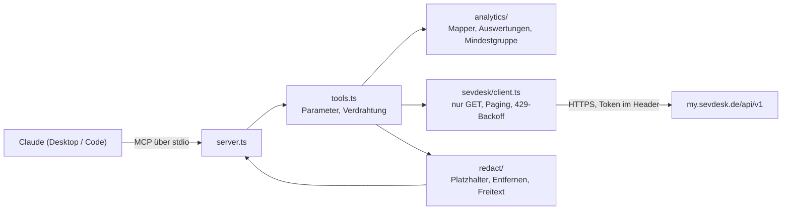

# Architektur

Der Connector ist ein MCP-Server über stdio. Er hat dieselbe Struktur wie der Lexware-Office-Connector. Das Systemdesign mit Belegstatus je Annahme steht in [DESIGN.md](DESIGN.md).

## Bausteine

| Datei | Aufgabe |
|---|---|
| `src/main.ts` | Start, liest `SEVDESK_TOKEN`, `SEVDESK_REDACT`, `SEVDESK_MIN_GROUP` |
| `src/server.ts` | Registriert die Tools, alle mit `readOnlyHint` |
| `src/tools.ts` | Tool-Definitionen, Zeitraum, Cache, Fehlerumwandlung |
| `src/sevdesk/client.ts` | GET mit Token ohne Präfix, Paging, Wiederholung bei 429 |
| `src/analytics/index.ts` | Mapper (Whitelist) und Auswertungen |
| `src/redact/index.ts` | Pseudonyme, Entfernen von Adress- und Steuerfeldern, Freitext-Muster |

## Entscheidungen

- **Nur GET.** Der Client kennt keine andere Methode. Schreibzugriff ist kein Ziel.
- **Token ohne Präfix.** sevDesk erwartet den Token direkt im Header `Authorization`, ohne `Bearer`.
- **Paging mit explizitem `limit`.** Ohne `limit` liefert die API alle Treffer, eine stille Kappung bei großen Beständen ist nicht ausgeschlossen. Der Client setzt `limit=1000` und blättert mit `offset`.
- **Datumsfilter in Sekunden.** Millisekunden liefern keine Treffer. Der Zeitraum wird mit einem Tag Spielraum abgefragt und lokal exakt gefiltert.
- **Whitelist-Mapper.** Von Rechnung und Gutschrift gelangen nur Nummer, Typ, Status, Datum, Zahlungsziel, Brutto, bezahlter Betrag und Kontakt-ID in die Auswertung. Alles andere wird nicht weitergegeben.
- **Gutschriften getrennt.** `GET /CreditNote` ist ein eigener Endpunkt, Gutschriften haben kein `paidAmount`.
- **Mindestgruppe statt Anonymisierung.** Eine Auswertung über weniger als fünf Kunden wird unterdrückt.
- **Stornorechnungen in v0.3.** Bis dahin sind sie aus allen Summen ausgeschlossen, mit Hinweis im Ergebnis.
- **USt nacheinander.** Die Positionsabrufe laufen bewusst sequenziell, weil das Ratenlimit unbekannt ist. Parallelisierung ist als spätere Optimierung vorgemerkt.

## Bekannte API-Eigenheiten

Gefunden am Testkonto, Details in [DESIGN.md](DESIGN.md) (Abschnitt 9): `taxRule 1` ist in Kleinunternehmer-Konten nur als Entwurf möglich, Gutschriften erreichen nie Status 1000, `getIsPartiallyPaid` ist bei Gutschriften immer `false`, `changeStatus` entfällt mit Update 2.0.
