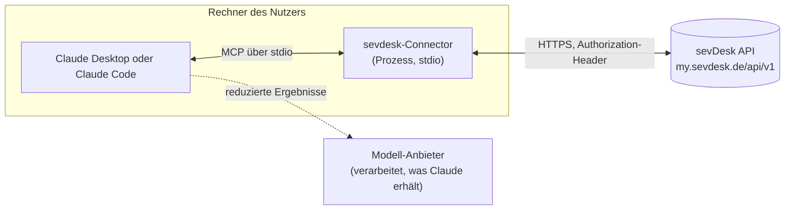
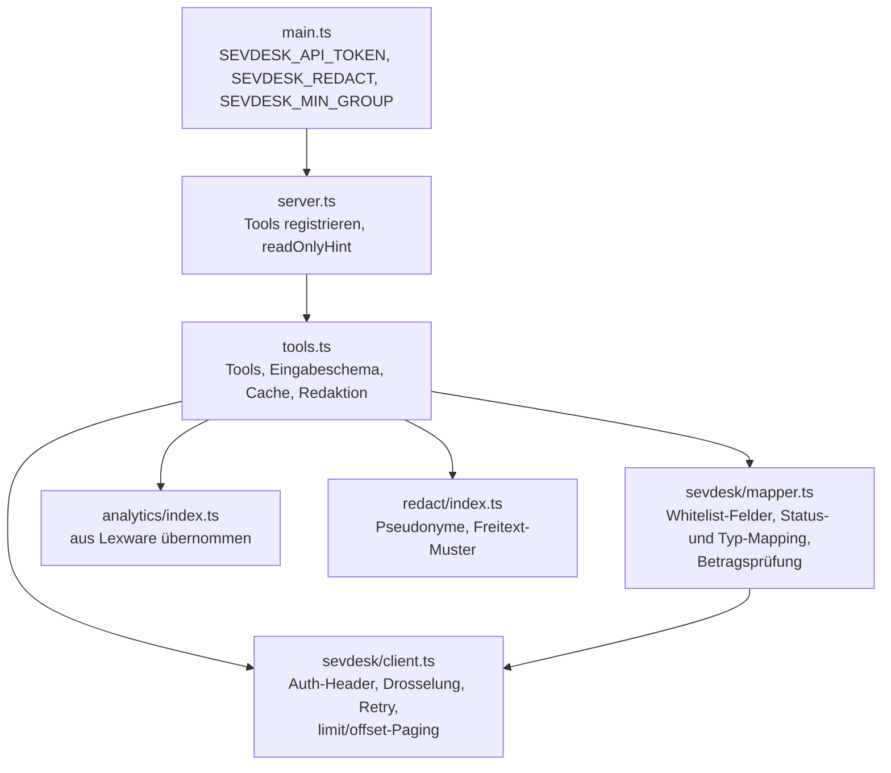
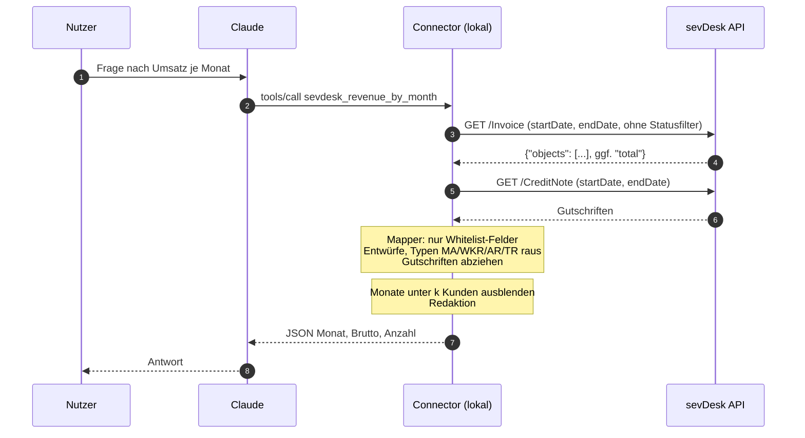

# Systemdesign: claude-sevdesk-connector

Status: Entwurf v2, Phase 0 teilweise abgeschlossen
Ziel: MCP-Connector für sevDesk, analog zu `claude-lexware-office-connector`, im KMU-Connector-Programm von [m-ko.de](https://m-ko.de).

## 0. Quellenlage

| Quelle | Stand | Verwendung |
|---|---|---|
| Doku-Seite `https://api.sevdesk.de/` (gespeichert vom Verantwortlichen) | Vollständig lesbar, Version sevDesk API 2.0.0 | Auth, Paging, Fehlercodes, Statusbedeutungen, Rechnungstypen |
| OpenAPI-Spezifikation `https://api.sevdesk.de/openapi.yaml` (öffentlich, ohne Token geladen) | 119 Pfade, 76 Schemas | Endpunkte, Filter, Feldnamen, Enums |
| Drittquellen (SDKs, Connector-Doku) | Sekundär | Nur noch als Hinweis, durch Quellen oben ersetzt oder widerlegt |
| `tech.sevdesk.com` (API-News) | Nicht erreichbar (DNS) | Offen, siehe Phase 0 |

**Basis-URL:** `https://my.sevdesk.de/api/v1`. Die Doku-Seite `api.sevdesk.de` ist nur die Dokumentation, nicht die API.

Die Angaben in den Abschnitten 5 und 6 sind mit **[belegt]** (Doku oder Spezifikation) oder **[offen]** (nur durch Live-Test klärbar) gekennzeichnet.

---

## 1. Anforderungen

### 1.1 Funktional

- Claude beantwortet Fragen zu Ausgangsbelegen, Kontakten, Artikeln und Auswertungen aus sevDesk.
- Funktionsumfang analog zu Lexware: Stammdaten, Belege, vier Auswertungen (offene Posten, Umsatz je Monat, Kundenkonzentration, USt-Übersicht).
- Nur lesend. Keine Rechnungen anlegen, ändern, finalisieren, stornieren oder buchen.
- Nur Ausgangsbelege. Eingangsbelege (Vouchers), Banktransaktionen, Buchungskonten und Lohndaten sind nicht erreichbar.

### 1.2 Nicht-funktional

| Anforderung | Zielwert | Begründung |
|---|---|---|
| Datensparsamkeit | Standard an: Namen pseudonymisiert, Adressen, Steuer-IDs, Bankdaten entfernt, Freitext bereinigt | Gleiches Schutzniveau wie Lexware |
| Kleine Gruppen | Schwelle k = 5, konfigurierbar | Übernahme aus Lexware |
| Latenz | Listen und Detailabfragen unter ca. 5 s bei üblichem KMU-Volumen | Interaktive Nutzung |
| Verfügbarkeit | Kein eigener Dienst, keine SLA. Fehler als Tool-Fehler, Prozess bleibt stabil | Lokaler Prozess |
| Kosten | Keine Infrastruktur, keine laufenden Kosten | MIT-Lizenz, kostenlos |
| Geheimnisse | Token in keiner Log-, Fehler- oder Antwortausgabe | Wie Lexware |

### 1.3 Randbedingungen

- Projektmuster wie Lexware: TypeScript, Vitest, MCP-SDK, Node ≥ 22.
- Die Doku empfiehlt ein Testkonto (Trial, höchster Tarif), damit alle Funktionen prüfbar sind **[belegt]**.
- Die Doku nennt einen `User-Agent`-Header, der den Integrationsnamen tragen soll **[belegt]**. Verwendet wird `claude-sevdesk-connector/<Version>`, ohne personenbezogene Angaben.

### 1.4 Nicht im Umfang

- Schreibzugriff, auch nicht Statuswechsel oder Stornierung.
- Eingangsbelege, Banktransaktionen, Export-Endpunkte (DATEV, ZIP), Lohn- und Personaldaten.
- Gehosteter Server. Der Connector bleibt lokal.

---

## 2. Systemüberblick

Der Connector läuft als Prozess auf dem Rechner des Nutzers. Claude startet ihn über MCP per stdio. Er spricht über HTTPS mit `my.sevdesk.de/api/v1`, mit dem persönlichen API-Token des Nutzers. Auswertungen laufen lokal, Antworten werden vor der Ausgabe reduziert.



Die gestrichelte Linie bleibt die wichtigste Grenze: Was Claude verarbeitet, geht an den Modell-Anbieter. Der Connector verkleinert diesen Datenstrom, verhindert ihn aber nicht.

---

## 3. Komponenten



| Datei | Aufgabe | Quelle |
|---|---|---|
| `src/main.ts` | Einstieg, Umgebungsvariablen, stdio-Transport, Fehler nach stderr | Muster Lexware |
| `src/server.ts` | MCP-Server, Tool-Registrierung | übernommen |
| `src/tools.ts` | Tool-Definitionen, Redaktion vor Ausgabe | neu |
| `src/sevdesk/client.ts` | HTTP-Client | neu, Gerüst aus Lexware |
| `src/sevdesk/mapper.ts` | sevDesk-Objekte in interne Typen, nur Whitelist-Felder | neu |
| `src/analytics/index.ts` | Aging, Umsatz, Konzentration, USt | übernommen, interne Typen angepasst |
| `src/redact/index.ts` | Pseudonyme, Entfernung, Freitext | übernommen, Feldliste angepasst |

Code wird kopiert, nicht als gemeinsames Paket ausgelagert (Begründung in Abschnitt 8).

---

## 4. Datenfluss



Die Auswertung rechnet auf den Rohdaten, die Redaktion folgt danach. Rohdaten (Namen, Adressen, Bankdaten, interne Notizen) verlassen den Connector nie.

---

## 5. API-Anbindung

### 5.1 Authentifizierung

- **[belegt]** Jeder Administrator hat ein 32-stelliges hexadezimales Token. Es wird im Header `Authorization` übergeben, als reiner Wert, ohne Präfix: `Authorization: <token>`. Die Spezifikation definiert ein `apiKey`-Schema im Header `Authorization`.
- **[belegt]** Tokens haben keine Ablaufzeit. Sie können im Profil neu erzeugt werden. Ein Token nach dem Erzeugen ist nicht mehr abrufbar, also muss der Nutzer es sofort sichern.
- **[belegt]** Fehlendes oder falsches Token: HTTP 401.
- **[offen, Testaufruf]** Ob `Bearer` abgelehnt wird. Der Connector sendet den Wert ohne Präfix, wie dokumentiert.

### 5.2 Verbindungstest

`GET /Tools/bookkeepingSystemVersion` **[belegt]** liefert die Buchhaltungsversion des Kontos. Dieser Aufruf dient als günstiger Verbindungs- und Token-Test und entscheidet über den Steuer-Modus (siehe 5.7).

### 5.3 Drosselung

- **[belegt: nicht dokumentiert]** Weder Doku noch Spezifikation nennen ein Ratenlimit. Auch HTTP 429 ist in den Fehlertabellen nicht aufgeführt.
- Vorgehen trotzdem: Mindestabstand zwischen Anfragen (Startwert 500 ms), Wiederholung bei 429 mit `Retry-After` oder exponentiellem Backoff, höchstens drei Versuche.
- **[offen]** Tatsächliches Verhalten unter Last im Live-Test messen.

### 5.4 Paging

- **[belegt]** Parameter `limit` (1 bis 1000) und `offset`. Die Doku empfiehlt 10 bis 100.
- **[belegt]** `countAll=true` liefert ein Feld `total`. Es ist als **Zeichenkette** dokumentiert (`"total": "157"`).
- **[belegt]** Antwortform: `{"objects": [...]}`.
- **[Widerspruch, offen]** Die Doku beschreibt `limit`/`offset` allgemein. Die Spezifikation deklariert sie aber nur bei Unterressourcen (`/Invoice/{id}/getPositions`, `/Order/{id}/getPositions`, `/Order/{id}/getDiscounts`), nicht bei `GET /Invoice` oder `GET /Contact`.

**Konsequenz:** Ob `GET /Invoice` und `GET /Contact` tatsächlich paginieren, ist ein Blocker für die Belegliste. Im Live-Test prüfen (V4). Ergibt der Test, dass dort kein Paging möglich ist, gilt die Liste als unvollständig, und der Connector meldet das statt still abzuschneiden.

### 5.5 Endpunkte für die Tools

| Zweck | Endpunkt | Filter (laut Spezifikation) |
|---|---|---|
| Verbindungstest | `GET /Tools/bookkeepingSystemVersion` | keine |
| Rechnungen | `GET /Invoice` | `status` (nur 100, 200, 1000), `invoiceNumber`, `startDate`, `endDate` (Integer), `contact[id]`, `contact[objectName]` |
| Rechnungsdetail | `GET /Invoice/{id}` | – |
| Positionen | `GET /Invoice/{id}/getPositions` (limit, offset, embed) oder `GET /InvoicePos?invoice[id]=` | Steuersatz je Position |
| Gutschriften | `GET /CreditNote` | `status` (String), `creditNoteNumber`, `startDate`, `endDate`, `contact[id]` |
| Kontakte | `GET /Contact` | **nur `customerNumber` und `depth`, kein Namensfilter** |
| Kontakt | `GET /Contact/{id}` | – |
| Artikel | `GET /Part` | `partNumber`, `name` |
| Artikel-Bestand | `GET /Part/{id}/getStock` | nicht im v0.1-Umfang |

**Nicht verwendet:** `/Voucher`, `/VoucherPos`, `/CheckAccountTransaction`, `/Export/*`, `/Report/*` (Eingangsbelege, Banken, Dateiexporte), `/Order*` (v0.1).

### 5.6 Statuscodes

**Rechnungen [belegt]:**

| Code | Bedeutung | Auswertung |
|---|---|---|
| 50 | Deaktivierte Wiederholungsrechnung | Ausschluss (Vorlage, kein Beleg) |
| 100 | Entwurf | Ausschluss, wie Lexware |
| 200 | Offen / fällig | Offene Posten, Umsatz |
| 750 | Teilweise bezahlt (seit Release 4.181, Juni 2024) | Offene Posten mit Restbetrag, Umsatz |
| 1000 | Bezahlt | Umsatz |

- **Wichtig:** Der Listenfilter `status` erlaubt nur 100, 200 und 1000. Teilweise bezahlte Rechnungen (750) und deaktivierte Wiederholungsrechnungen (50) lassen sich nicht filtern. Der Connector lädt deshalb ohne Statusfilter und filtert lokal.
- **Hinweis aus der Doku:** Rechnungen, die vor Juni 2024 teilweise bezahlt waren, haben weiter Status 200. Für sie ist `GET /Invoice/{id}/getIsPartiallyPaid` **[belegt]** nötig. Das kostet einen Abruf je Rechnung. Die Auswertung nutzt stattdessen `paidAmount` (Feld des Rechnungsobjekts **[belegt]**), wenn es vorhanden ist. **[offen]** Ob `paidAmount` bei Altfällen gefüllt ist.

**Gutschriften [belegt]:** 100 Entwurf, 200 Offen/Versendet, 750 Teilweise bezahlt, 1000 Bezahlt. Die Spezifikation nennt zusätzlich 300 und 500, deren Bedeutung nur für Sonderfälle wie Lizenzgebühren gilt (Royalty), nicht für normale Gutschriften. Sie werden ausgeschlossen und als `unknown` gezählt.

**Kontakte [belegt]:** 100 Lead, 500 Ausstehend, 1000 Aktiv.

### 5.7 Rechnungstypen und Steuermodus

**Rechnungstypen [belegt]:**

| Typ | Bedeutung | Umsatz | Offene Posten |
|---|---|---|---|
| RE | Normale Rechnung | ja | ja |
| ER | Schlussrechnung (fasst AR und TR zusammen) | ja | ja |
| TR | Teilrechnung | nein, sonst doppelt gezählt | nein |
| AR | Abschlagsrechnung | nein, sonst doppelt gezählt | nein |
| WKR | Wiederkehrende Vorlage (erzeugt RE) | nein | nein |
| SR | Stornorechnung | **[offen, V8]** | nein |
| MA | Mahnung | nein | nein |

**Steuermodus [belegt]:** sevDesk hat seit Update 2.0 die Steuerregeln geändert (`taxRule` statt `taxType`/`taxSet`). Alte Konten laufen mit Update 1.0. Der Mapper liest beide Varianten. `GET /Tools/bookkeepingSystemVersion` entscheidet, welche gilt. Bei Update 2.0 steht der Steuersatz an jeder Position (`taxRate`), nicht mehr am Rechnungskopf (dort als veraltet markiert). Neue Positionen mit ungültigem Steuersatz liefern HTTP 422 **[belegt]**.

**Kleinunternehmer [belegt]:** Das Rechnungsobjekt hat `smallSettlement` (boolean). Bei `true` darf die Rechnung keine Umsatzsteuer ausweisen. Die USt-Übersicht prüft das Flag und rechnet dann nicht.

### 5.8 Fehlerabbildung

| HTTP | Meldung an Claude | Bemerkung |
|---|---|---|
| 400 | "sevDesk hat die Anfrage abgelehnt." | Pfad, kein Antworttext |
| 401 | "sevDesk lehnt das Token ab. Token prüfen oder neu erzeugen." | Kein Token in der Meldung |
| 403 | "sevDesk verweigert den Zugriff auf diese Ressource." | Rechte des Kontos prüfen |
| 404 | "Nicht gefunden." | |
| 429 | Wiederholung, danach Fehler | nicht dokumentiert, defensiv |
| 500 | "sevDesk ist gerade nicht erreichbar." | |
| Netzfehler | kurze Meldung ohne vollständige URL | URLs mit Filtern können Daten enthalten |

Fehlermeldungen enthalten nur Status und Pfad, nie den Antworttext, wie bei Lexware.

---

## 6. Tools, Datenmodell und Auswertungen

### 6.1 Tool-Liste v0.1

| Bereich | Tool | Entspricht Lexware | Hinweis |
|---|---|---|---|
| Stammdaten | `sevdesk_profile` | `lexware_profile` | Parität zu Lexware. Quelle: `GET /SevClient` (Whitelist, siehe 7.2) plus `GET /Tools/bookkeepingSystemVersion` |
| | `sevdesk_search_contacts` | `lexware_search_contacts` | Namenssuche **lokal** über die Kontaktliste, da kein Namensfilter existiert |
| | `sevdesk_get_contact` | `lexware_get_contact` | |
| | `sevdesk_search_articles` | `lexware_search_articles` | `GET /Part` mit `partNumber` oder `name` |
| Belege | `sevdesk_list_invoices` | `lexware_list_vouchers` | Parameter `documentType`: `invoice` oder `creditnote` |
| | `sevdesk_get_invoice` | `lexware_get_invoice` | Kopf plus Positionen |
| Auswertungen | `sevdesk_aging_report` | `lexware_aging_report` | |
| | `sevdesk_revenue_by_month` | `lexware_revenue_by_month` | |
| | `sevdesk_customer_concentration` | `lexware_customer_concentration` | |
| | `sevdesk_vat_summary` | `lexware_vat_summary` | Positionen je Rechnung nötig |

**Entscheidung (Nutzer, Punkt 2):** v0.1 hat mindestens den Umfang des Lexware-Connectors, also mit `sevdesk_profile`. Die Spezifikation nennt keinen Profil-Endpunkt, am Testkonto antwortet aber `GET /SevClient` mit HTTP 200 (V10). Das Tool nutzt nur die Whitelist aus 7.2. Der Endpunkt ist nicht zugesichert, deshalb prüft der Connector bei jedem Start, ob `SevClient` antwortet, und meldet andernfalls „Profil derzeit nicht verfügbar“, statt die Auswertungen zu blockieren.

### 6.2 Kontaktsuche ohne Namensfilter

`GET /Contact` filtert nur nach `customerNumber`. Eine Namenssuche wie bei Lexware gibt es nicht. Vorgehen:

1. Kontakte seitenweise laden (sofern Paging greift, V4), mit Cache im Prozessspeicher.
2. Lokal nach `name`, `surename`, `familyname` und `name2` filtern.
3. Nur Pseudonym und Anzahl ausgeben, wie Lexware.

**Folge:** Bei großen Kontaktlisten dauert die erste Suche länger. Die Kontaktliste bleibt nur im Arbeitsspeicher. Für sehr große Mandanten wird ein Limit gesetzt (Startwert 5.000 Kontakte, konfigurierbar), mit Hinweis, falls abgeschnitten.

### 6.3 Internes Datenmodell

```ts
type Document = {
  id: string;
  documentType: "invoice" | "creditnote";
  invoiceType?: "RE" | "ER" | "TR" | "AR" | "WKR" | "SR" | "MA"; // nur Rechnungen
  status: "draft" | "open" | "partiallyPaid" | "paid" | "excluded" | "unknown";
  number: string;
  date: string;             // yyyy-MM-dd, aus Timestamp
  dueDate?: string;
  contactId: string;
  contactName: string;      // vor Redaktion
  netTotal: number;         // sumNet, Zahl laut Spezifikation
  taxTotal: number;         // sumTax
  grossTotal: number;       // sumGross
  paidAmount?: number;      // paidAmount, nur wenn vorhanden
  smallSettlement: boolean;
  taxRows?: { ratePercent: number; net: number; tax: number }[]; // aus Positionen
};
```

- **[belegt]** Beträge sind laut Spezifikation JSON-Zahlen (`float`). Die Zeichenketten-Variante gilt nur für `total` im Zählwert. Der Mapper prüft trotzdem jeden Betrag und lehnt Unpassendes ab, statt 0 anzunehmen.
- **[belegt]** Die Summen `sumNet`, `sumTax`, `sumGross` sind schreibgeschützte Felder des Rechnungsobjekts. Umsatz und Aging brauchen deshalb keine Positionen.
- **[belegt]** Steuersätze stehen an den Positionen (`taxRate`, `priceNet`, `priceTax`, `priceGross`). Die USt-Übersicht braucht daher je Rechnung einen Positionsabruf.

### 6.4 Auswertungsregeln

- **Umsatz je Monat:** Typen RE und ER, Status 200, 750 und 1000, minus Gutschriften (Status 200, 750, 1000). Entwürfe, Vorlagen, Mahnungen und Teil-/Abschlagsrechnungen sind ausgenommen. Brutto wie bei Lexware.
- **Offene Posten:** Typen RE und ER, Status 200 und 750. Restbetrag = `sumGross - paidAmount`, sofern `paidAmount` vorhanden. Sonst Gesamtbetrag, mit Hinweis.
- **Konzentration:** wie Lexware, auf Umsatzbasis.
- **USt:** Positionen je Rechnung, Summen je Steuersatz. Rechnungen mit `smallSettlement = true` getrennt ausweisen. Rechnungen ohne Positionen wie bei Lexware getrennt ausweisen. Obergrenze 200 Rechnungen (`SEVDESK_VAT_MAX_INVOICES`).
- **Unbekannte Status** (50, 300, 500, unbekannte Werte) fließen in keine Summe. Ihre Anzahl wird im Ergebnis genannt.
- **Stornierungen** (SR): **Entscheidung (Nutzer, Punkt 4): Storno-Logik kommt in v0.3.** In v0.1 werden SR-Belege aus allen Summen ausgeschlossen. Jede Auswertung nennt in ihrem Ergebnis den Hinweis "Stornorechnungen sind in dieser Version nicht berücksichtigt". So entsteht keine Doppelzählung, und es wird nichts still falsch gerechnet.

### 6.5 Caching und Abrufmenge

| Abruf | Kosten | Maßnahme |
|---|---|---|
| Rechnungsliste (Zeitraum) | Seiten à 100 | keine Erweiterung |
| Positionen für USt | ein Abruf je Rechnung | Cache im Prozess, Obergrenze 200 |
| Kontaktliste | Seiten à 100, einmalig | Cache im Prozess |
| Teilzahlungsprüfung für Altfälle | ein Abruf je Rechnung | nur bei fehlendem `paidAmount`, mit Obergrenze |

---

## 7. Datenschutz und Redaktion

### 7.1 Gleiche Standards wie Lexware

| Maßnahme | Standard | Wirkung |
|---|---|---|
| Namen | Pseudonym `Kontakt N` | ein Name bekommt im Prozess immer dieselbe Nummer |
| Adressen | Straße, Zusatz, PLZ entfernt | Ort und Land bleiben |
| Steuer-IDs | entfernt | `taxNumber`, `vatNumber` |
| Freitext | E-Mail, IBAN, Telefon, USt-IdNr. ersetzt | gilt für alle Textfelder |
| Kleine Gruppen | k = 5 | `suppressed: true` |
| Konzentration | nur Anteilsklassen | keine Namen, keine Beträge |
| Speicherung | keine | nur Arbeitsspeicher |

Umschalter: `SEVDESK_REDACT=0`, `SEVDESK_MIN_GROUP=1`, mit Hinweis wie bei Lexware.

### 7.2 Whitelist statt Blacklist

Der Mapper übernimmt nur Felder aus einer festen Liste. Neue Felder der API fließen nie automatisch durch. Das ist die wichtigste Abweichung zu Lexware.

**Verworfen, auch bei `SEVDESK_REDACT=0` [belegt: Feldnamen aus Spezifikation]:**

| Objekt | Feld | Grund |
|---|---|---|
| Rechnung | `customerInternalNote` | interne Notiz, Freitext |
| Rechnung | `address` | vollständige Anschrift inkl. Name |
| Rechnung | `header`, `headText`, `footText` | Freitext, oft mit Namen (Muster ersetzen, nicht übernehmen) |
| Rechnung | `propertyIsEInvoice`-Block, `sevClient` | Anschrift und Bankdaten des Absenders |
| Rechnung | `payDate`, `sendDate`, `createUser` | nicht benötigt, Personenbezug bei `createUser` |
| Kontakt | `bankAccount`, `bankNumber` | Bankdaten |
| Kontakt | `birthday`, `gender`, `titel`, `academicTitle` | personenbezogen, nicht benötigt |
| Kontakt | `taxNumber`, `vatNumber`, `taxOffice` | Steuer-IDs |
| Kontakt | `description`, `buyerReference` | Freitext |
| Artikel | `internalComment` | interne Notiz |

**Übernommen (reduziert):** Kontakt `customerNumber`, `status`, `category`-Name; Rechnung `id`, Typ, Status, Datum, Summen, `paidAmount`, `smallSettlement`, `contact.id`; Position `taxRate`, `priceNet`, `priceTax`.

**Profil (`SevClient`, belegt am Testkonto):**

| Feld | Behandlung | Begründung |
|---|---|---|
| `name` | ausgeben, **nur wenn kein `@` enthalten** | Am Testkonto steht hier die Login-E-Mail-Adresse |
| `formOfCompany`, `smallSettlement`, `defaultCurrency`, `invoiceTimeToPay`, `showNet` | ausgeben | nicht personenbezogen, für Auswertungen relevant |
| `taxNumber`, `vatNumber`, `companyRegister`, `districtCourt` | entfernen | Steuer- und Registerdaten |
| `bankIban`, `bankBic`, `bankAccountNumber`, `bankNumber`, `bank`, `bank2`, `paypalEmail`, `figoUsername` | entfernen | Finanzdaten |
| `addressStreet`, `addressZip`, `addressCity`, `addressCountry`, `nameAddition` | entfernen | Anschrift |
| `contactEmail`, `contactPhone`, `contactFax`, `website`, `ceoName` | entfernen | Kontakt- und Personendaten |
| alle übrigen Felder (Druck, Vorlagen, Abo, Partner, Onboarding) | entfernen | nicht benötigt |

**Import-Befund (Testkonto):** Der CSV-Import hat die Spalten fehlerhaft zugeordnet. `Strasse` landete in `name`, `PLZ` in `name2`, `E-Mail` in `bankAccount`, `Kategorie` in `surename`, und die Organisationsnamen fehlen. Die Kundennummern stimmen. Das ist ein Fehler der Zuordnung im Assistenten und kein Fehler der API. Für den Mapper bedeutet das: Die Whitelist muss mit falsch befüllten Feldern umgehen, und Auswertungen dürfen sich nicht auf Feldinhalte stützen, die nur die Spalte gesetzt hat.

### 7.3 Token

- Das Token ist ein Schlüssel für das gesamte Konto **[belegt: lebt, solange der Benutzer existiert]**. Es steht im `env`-Block der Claude-Konfiguration, im Klartext wie bei Lexware.
- Die Doku warnt, dass ein Benutzer nicht gelöscht werden sollte, weil das Token dann verloren geht **[belegt]**. Das gehört in die Anleitung.
- Scope: **[offen]** ob sevDesk lesende Tokens anbietet. Die Doku erwähnt keine Rechtestufen. Restrisiko in der Dokumentation nennen.

---

## 8. Entscheidungen und Trade-offs

| Entscheidung | Alternative | Begründung | Trade-off | Revisit |
|---|---|---|---|---|
| Code kopieren, kein gemeinsamer Core | gemeinsames Paket | erst zwei Umsetzungen, dann Abstraktion | Fehler doppelt beheben | bei drittem Connector |
| Lokaler stdio-Server | gehosteter Server | Token und Daten bleiben beim Nutzer | Node.js nötig | bei Nicht-Technikern als Hauptnutzern |
| Nur lesend | Schreibtools | Buchhaltung verändern ist riskant | kein Nutzen für Automatisierung | eigenes Design mit Freigabe |
| Whitelist im Mapper | Blacklist wie bei Lexware | sevDesk-Objekte sind umfangreicher, mit mehr Freitext und Bankdaten | Pflege bei API-Änderungen | bei jeder API-Version |
| Lokale Statusfilterung | Filter an der API | Filter kennt 750 und 50 nicht | größere Antwort | nach Live-Test (V5) |
| Namenssuche lokal | serverseitige Suche | Endpunkt hat keinen Namensfilter | erster Aufruf langsamer | wenn sevDesk einen Filter einführt |
| Profil-Tool in v0.1 (Parität zu Lexware) | Profil weglassen | Nutzer erwartet mindestens den Lexware-Umfang. Profil nur mit nicht-personenbezogenen Angaben | Ohne belegten Endpunkt eingeschränkt (kein Firmenname) | nach V10 |
| Stornos erst in v0.3 | Storno-Logik in v0.1 | Ausschluss mit Hinweis verhindert Doppelzählung, Storno-Verhalten ist noch nicht am Testkonto belegt | Auswertungen bis v0.3 ohne Storno-Korrektur, mit Hinweis | v0.3 |

---

## 9. Verifikation (Phase 0)

Die Spezifikation und Doku klären viel. Verbleibende Punkte brauchen ein Testkonto (Trial, höchster Tarif) mit Beispieldaten. Die Testtoken gehören nur in die lokale Umgebung, nie in ein Repo.

| # | Prüfpunkt | Status | Methode |
|---|---|---|---|
| V0 | Credential-Format am Proxy | **erledigt**: nach Neusetzung des Secrets antwortet `GET /Tools/bookkeepingSystemVersion` mit HTTP 200. Der Wert ohne Präfix funktioniert | – |
| V1 | Basis-URL | **belegt** | Doku, Spezifikation |
| V2 | Header-Format (ohne Bearer) | **belegt**, Live-Bestätigung offen | Testaufruf mit und ohne Präfix |
| V3 | Ratenlimit, Verhalten bei Überschreitung | offen, nicht dokumentiert | kontrollierte Aufrufreihe, Header prüfen |
| V4 | Paging auf `GET /Invoice` und `GET /Contact` (limit, offset, countAll) | **Widerspruch**, Live-Test nötig | Abfrage mit limit=10, offset=10 |
| V5 | Statuscodes: Rechnung 50/750, Gutschrift 750; Verhalten bei Filter | teilweise belegt | Testbelege in jedem Status |
| V6 | Einheit der Datumsfilter (Sekunden oder Millisekunden) | offen | Abfrage mit bekanntem Datum |
| V7 | `paidAmount` bei Altfällen (vor Juni 2024) | offen | Testkonto mit altem Datenstand, falls vorhanden |
| V8 | Stornierung: Status der Quellrechnung nach SR | offen | Stornorechnung im Testkonto anlegen, Liste prüfen |
| V9 | Verhalten bei fehlendem Paging-Parameter | offen | nach V4 |
| V10 | Existenz eines Firmenprofil-Endpunkts | **teilweise belegt**: `GET /SevClient` antwortet mit HTTP 200 und liefert das Kontoprofil. Der Endpunkt steht **nicht** in der Spezifikation, daher ist sein Verhalten (Stabilität, Felder, Versionierung) nicht zugesichert. `GET /SevUser` existiert ebenfalls, wird aber nicht verwendet (Login- und Personendaten) |
| V11 | Steuer-Modus des Testkontos (1.0 oder 2.0) | **belegt: 2.0** | `GET /Tools/bookkeepingSystemVersion` liefert `{"version":"2.0"}`. Der Update-1.0-Pfad bleibt im Mapper, ist aber am Testkonto nicht prüfbar |
| V12 | Kleinunternehmer-Konto: `smallSettlement` und Positionen | offen | Testkonto mit passender Einstellung |
| V13 | Zugriff nur für bestimmte Tarife | offen | Testkonto, Doku der Preisseite prüfen |
| V14 | `tech.sevdesk.com` (API-News) | offen | Zugriff nicht möglich, Inhalte nachholen |

**Ergebnis** wird als Fixture-Sammlung unter `test/fixtures/` abgelegt, mit synthetischen Werten und Pseudonymen, vor dem Commit geprüft.

---

## 10. Teststrategie

| Ebene | Was | Werkzeug |
|---|---|---|
| Client | Auth-Header ohne Präfix, Paging, Drosselung, Retry bei 429, keine Tokens in Fehlern | Vitest, gefälschtes `fetch` |
| Mapper | Whitelist, Statusmapping, Typmapping, Betragsprüfung, Update 1.0 und 2.0 | Vitest mit Fixtures |
| Analytics | übernommene Fälle plus Teilzahlung, Gutschrift, Typen, Kleinunternehmer | Vitest |
| Redaktion | Pseudonyme, Freitext, Whitelist-Verwurf auch bei abgeschalteter Redaktion | Vitest |
| Tools | Tool-Liste, Schemata, Abrufmenge pro Tool | Vitest |
| MCP-Server | In-Memory-Transport | Vitest |
| Live-Check | lesend gegen Testkonto, gibt keine Namen aus | `scripts/live-check.mjs` mit `SEVDESK_API_TOKEN` |

Die Tests laufen ohne Token und Netz. Der Live-Check ist manuell und bricht ohne Token ab.

---

## 11. Betrieb und Auslieferung

- **Entscheidung (Nutzer, Punkt 3): öffentliches Repo unter MIT**, mit `LICENSE`-Datei wie bei Lexware. Das Repo `muka-dev/claude-sevdesk-connector` ist bereits öffentlich.
- Paket: npm-Name `claude-sevdesk-connector` (Verfügbarkeit prüfen), Version 0.1.0.
- Versionsplan: **v0.1 ohne Storno-Logik**, Stornos in **v0.3** (Nutzer, Punkt 4). v0.2 ist noch nicht festgelegt.
- Dokumentation analog zu Lexware: README, `docs/API.md`, `docs/ARCHITECTURE.md`, `docs/SECURITY-PRIVACY.md`, `docs/TROUBLESHOOTING.md`.
- Projektseite auf m-ko.de: `connectors/sevdesk/` anlegen. In `connectors/index.html` wechselt sevDesk von "Geplant" zu "Verfügbar".
- Keine Telemetrie, keine Logdateien.
- Nutzer-Anleitung nennt die Doku-Stellen: Token-Erzeugung und Warnung vor dem Löschen des Benutzers.

---

## 12. Risiken

| Risiko | Wahrscheinlichkeit | Wirkung | Gegenmaßnahme |
|---|---|---|---|
| Paging auf `/Invoice` greift nicht (V4) | mittel | hoch: unvollständige Listen | Live-Test vor Bau, sonst Hinweis statt stiller Kürzung |
| Ratenlimit enger als gedacht | mittel | mittel: langsame Auswertungen | Abstand, Backoff, Cache, Obergrenze |
| Teilzahlungen falsch gewertet (750 vs. 200 bei Altfällen) | mittel | mittel: falsche offene Posten | `paidAmount` prüfen, Hinweis, V7 |
| Doppelzählung bei Stornierungen | mittel | hoch: falscher Umsatz | Hinweis bis V8 |
| Personendaten in unerwarteten Feldern | mittel | hoch | Whitelist, Test je Feld |
| Änderungen zwischen Update 1.0 und 2.0 | mittel | mittel | Mapper für beide Varianten, Versionsprüfung |
| Zugriff nur in bestimmten Tarifen (V13) | unbekannt | hoch | vor Bau klären |
| Fehlende Dokumentation von Ratenlimits | hoch | mittel | defensiv implementieren, im Live-Test messen |

---

## 13. Umsetzungsreihenfolge

1. **Phase 0:** V3 bis V13 am Testkonto, Ergebnis in Abschnitt 9 nachtragen. V14 nachholen, sobald der Zugang möglich ist.
2. **Phase 1:** Client, Auth, Paging, Fehler, Tests gegen Fixtures.
3. **Phase 2:** Mapper mit Whitelist, Analytics, Redaktion.
4. **Phase 3:** Tool-Schicht, MCP-Server, Tool-Tests.
5. **Phase 4:** Live-Check, Dokumentation, Projektseite.
6. **Phase 5:** Veröffentlichung nach Freigabe.

Eine Phase startet erst, wenn die Verifikation ihrer Punkte vorliegt.

---

## 14. Später überprüfen

- Gemeinsamer Core für Redaktion und Analytics, wenn ein dritter Connector ansteht.
- Angebote und Aufträge (`Order`) als eigene Tools.
- Firmenprofil, sobald ein belegter Endpunkt existiert.
- Schreibzugriff nur mit eigenem Design für Freigabe und Protokoll.
- Obergrenzen (200 Rechnungen, 5.000 Kontakte) nach Messung mit echten Daten.

---

## Offene Fragen an den Verantwortlichen

Entschieden (Nutzer):
1. Testaccount vorhanden, ohne Daten. Kontakt-Import als CSV erstellt: `testdata/contacts-import.csv`, Generator `testdata/generate_contacts.py`.
2. v0.1 mindestens Lexware-Umfang, inklusive Profil-Tool.
3. Öffentliches Repo, MIT.
4. Stornos in v0.3.

Offen (blockiert durch V0):
- Das gespeicherte Token braucht Korrektur am Präfix, siehe V0. Danach laufen V3 bis V13 am Testkonto.
- Die Belege für Umsatz, Offene Posten und USt fehlen im Testkonto. Der CSV-Import legt nur Kontakte an. Rechnungen müssen angelegt werden, entweder manuell im Testkonto oder per API. Ein API-Anlegen wäre eine Schreibaktion im Testkonto und braucht eine Freigabe.
